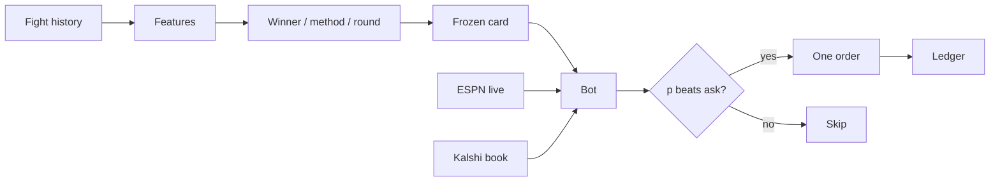

<div align="center">


UFC model that can trade fight-winner contracts on Kalshi.

</div>

## How it runs



Picks start from the frozen pre-fight card. With `--in-fight`, the live ESPN clock and stats reprice the fight, and the bot buys when that price still clears fees and depth.

## Kalshi bot

One command starts the ESPN fight feed, the bot, and the dashboard.

```bash
./ictus.sh paper              # practice, no money
./ictus.sh demo               # Kalshi demo account
./ictus.sh live 5             # real money; hard $5 cap per event
./ictus.sh paper --in-fight   # reprice from the live fight and bet during it
```

Open [http://localhost:3000](http://localhost:3000), set a spend limit, press **Start**.
Ctrl+C in that terminal stops everything.

- Matches tonight’s ESPN card to frozen picks and each Kalshi `KXUFCFIGHT` winner market
- Builds predictions on the page if none exist yet
- One pre-fight attempt sequence per fight. With `--in-fight`, the live clock and stats reprice the fight and the bot can buy about once a second while the edge lasts, plus between rounds
- Hard event budget; a stuck or unclear order pauses the session

Winner markets only. Method, round, and parlay contracts are skipped.

| Mode | What happens |
|---|---|
| `paper` | Public quotes, simulated fills. No Kalshi key needed. |
| `demo` | Real demo-exchange orders. Needs a Kalshi demo key. |
| `live` | Production orders. Type `yes`. The cap cannot be exceeded. |

The bot can spend nothing. **No proven edge over Kalshi.** Live mode can lose the whole limit.

[Setup and safety](model/docs/kalshi_trading.md) · [model evidence](model/docs/trading_model_readiness.md)
