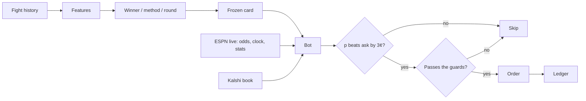

<div align="center">


UFC model that can trade fights live on Kalshi.

</div>

## How it runs



The bot bets one number per fight: the sportsbook line ESPN streams with the fight, nudged by the model. During a fight the live clock and stats reprice it. An order also has to pass the guards: no longshots under 20¢, never both fighters, and no buying a price that is falling.

## Kalshi bot

One command starts the ESPN fight feed, the bot, and the dashboard.

```bash
./ictus.sh              # practice, no money
./ictus.sh live 20      # real money; hard $20 cap on the event
./ictus.sh demo         # Kalshi demo account
./ictus.sh stop         # stop whatever an earlier run left running
```

Open [http://localhost:3000](http://localhost:3000), set a spend limit, press **Start**.
Ctrl+C in that terminal stops everything.

- Matches tonight’s ESPN card to saved predictions and each Kalshi `KXUFCFIGHT` winner market
- Builds predictions by itself if none exist yet
- Trades before and during fights; `--pre-fight-only` stops it at the opening bell
- Hard event budget; an unconfirmed order holds new orders until Kalshi confirms it
- Shows profit so far as fights finish

Winner markets only. Method, round, and parlay contracts are skipped.

| Mode | What happens |
|---|---|
| `paper` | Public quotes, simulated fills. No Kalshi key needed. |
| `demo` | Real demo-exchange orders. Needs a Kalshi demo key. |
| `live` | Production orders. Type `yes`. The cap cannot be exceeded. |


[Setup and safety](model/docs/kalshi_trading.md) · [model evidence](model/docs/trading_model_readiness.md)
