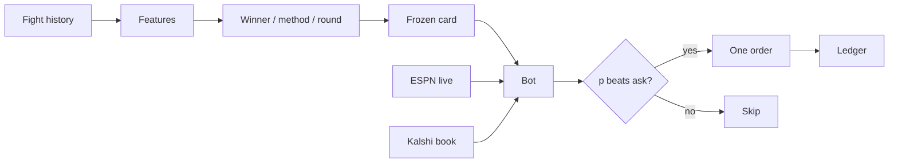

<div align="center">


UFC model that can trade fights live on Kalshi.

</div>

## How it runs



Picks are frozen before the event. The bot then watches ESPN and the Kalshi winner book and buys only when the model price still clears fees and depth.

## Kalshi bot

One command starts the ESPN fight feed, the bot, and the dashboard.

```bash
./ictus.sh paper              # practice, no money
./ictus.sh demo               # Kalshi demo account
./ictus.sh live 5             # real money; hard $5 cap per event
./ictus.sh paper --in-fight   # also bet between rounds
```

Open [http://localhost:3000](http://localhost:3000), set a spend limit, press **Start**.
Ctrl+C in that terminal stops everything.

- Matches tonight’s ESPN card to frozen picks and each Kalshi `KXUFCFIGHT` winner market
- Builds predictions on the page if none exist yet
- One order attempt per fight (or per round-break with `--in-fight`)
- Hard event budget; a stuck or unclear order pauses the session

Winner markets only. Method, round, and parlay contracts are skipped.

| Mode | What happens |
|---|---|
| `paper` | Public quotes, simulated fills. No Kalshi key needed. |
| `demo` | Real demo-exchange orders. Needs a Kalshi demo key. |
| `live` | Production orders. Type `yes`. The cap cannot be exceeded. |

The bot can spend nothing. **No proven edge over Kalshi.** Live mode can lose the whole limit.

[Setup and safety](model/docs/kalshi_trading.md) · [model evidence](model/docs/trading_model_readiness.md)
