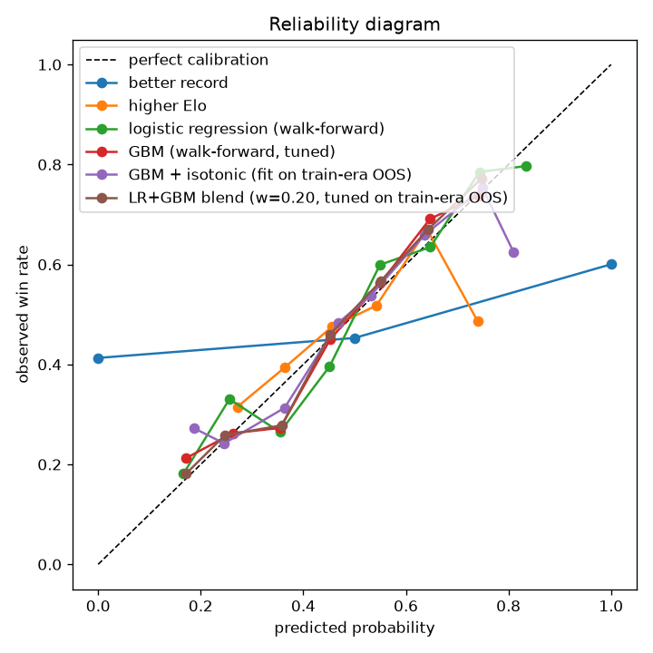

# Evaluation report — test split

Generated 2026-11-12 01:53 UTC. Fights dated (2023-12-31, 9999-12-31]. Walk-forward windows: 2024-01-01->2024-06-30, 2024-07-01->2024-12-31, 2025-01-01->2025-06-30, 2025-07-01->2025-12-31, 2026-01-01->2026-06-30, 2026-07-01->2026-11-07

Verified artifact: calibration/blend through 2021-12-31; reusable GBM hyperparameters tuned through 2021-12-31; historical feature fingerprint `97cd698a33747c2ffff80b8b5e306fbe4199ecabd8fd9a21bbecf7eaefe0fce8`.

| model | n | accuracy | log loss | Brier | ROC AUC | ECE | note |
|---|---|---|---|---|---|---|---|
| coin flip | 1516 | 0.5000 | 0.6931 | 0.2500 | 0.5000 | 0.0000 |  |
| better record | 1516 | 0.5831 | 10.0475 | 0.3889 | 0.5924 | 0.3661 |  |
| higher Elo | 1516 | 0.5597 | 0.6810 | 0.2440 | 0.5921 | 0.0316 |  |
| market (vig-free favorite) | - | - | - | - | - | - | no fights to score (priced fights only) |
| logistic regression (walk-forward) | 1516 | 0.6689 | 0.6277 | 0.2186 | 0.7077 | 0.0498 |  |
| GBM (walk-forward, tuned) | 1516 | 0.6474 | 0.6379 | 0.2231 | 0.6932 | 0.0288 |  |
| GBM + isotonic (fit on train-era OOS) | 1516 | 0.6468 | 0.6380 | 0.2232 | 0.6928 | 0.0301 |  |
| LR+GBM blend (w=0.20, tuned on train-era OOS) | 1516 | 0.6547 | 0.6328 | 0.2208 | 0.7025 | 0.0340 |  |

Better-record is a picking rule (0/0.5/1); its log loss is not meaningful. Compare probability metrics to the market row when it exists.

## Logistic regression — largest standardized coefficients

Positive means: the bigger fighter1's edge in this differential, the likelier fighter1 wins (per the model).

| feature | coefficient |
|---|---|
| diff_ko_end_rate_l5 | -0.544 |
| diff_dec_end_rate_l5 | -0.508 |
| diff_losses | +0.442 |
| diff_pre_ufc_sub_rate | +0.419 |
| diff_pre_ufc_ko_rate | +0.400 |
| diff_sub_end_rate_l5 | -0.379 |
| diff_style_age_wrestle | +0.359 |
| diff_avg_fight_min | +0.320 |
| diff_elo | +0.303 |
| diff_pre_ufc_finish_rate | -0.281 |
| diff_td15_l5 | +0.232 |
| diff_ko_win_rate | +0.225 |
| diff_strike_elo | +0.223 |
| diff_win_pct | -0.217 |
| diff_kd15_l5 | -0.209 |

## How the fight ends (method + round)

Both models are walk-forward and scored only where they apply: the method model on every decisive fight, the round model on finishes only (a decision has no round to predict). The method model answers how the winner wins (KO / submission / decision); fight-level KO/sub/dec is that split averaged across corners, which is what the scorecard grades. The round model answers a conditional question — given that this fighter finished by this method, which round? — so its opponent is the historical round split for the same method and the same fight length.

| method of victory (how the winner wins) | n | log loss | winner's method | fight KO/sub/dec |
|---|---|---|---|---|
| method model, shrunk (production, 75% model) | 1513 | 0.9181 | 56.9% | 54.2% |
| method model, unshrunk | 1513 | 0.9140 | 56.1% | 54.5% |
| base rate (division x scheduled rounds, recent era) | 1513 | 1.0008 | 51.0% | 50.8% |

| round of finish (1-5) | n | log loss | exact round | within 1 round |
|---|---|---|---|---|
| round model, shrunk (production, 45% model) | 774 | 1.0316 | 51.9% | 81.5% |
| round model, unshrunk | 774 | 1.0324 | 51.4% | 81.9% |
| base rate (method x scheduled rounds) | 774 | 1.0422 | 51.9% | 81.7% |

Uninformed reference: guessing uniformly over 3 methods costs 1.0986; over the 3 rounds of a standard fight, 1.0986. Read both tables with the base-rate row as the bar. Finish timing is close to a coin flip weighted by 'earlier is likelier', which is why the production model is shrunk toward that base rate rather than trusted outright.

---
Favorite baseline is ~65% accuracy / ~0.62 log loss on priced fights.